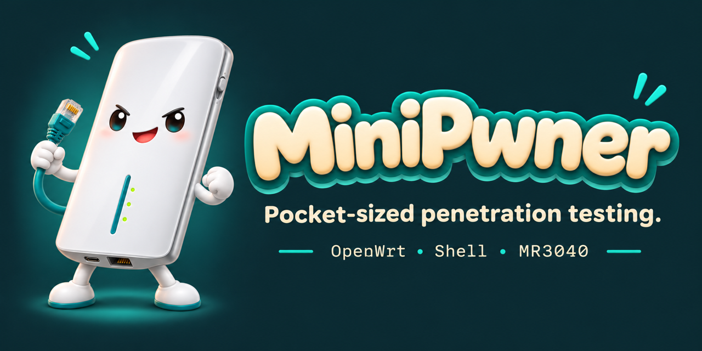

#  MiniPwner




[](../LICENSE)

MiniPwner configures a TP-Link MR3040 running OpenWrt as a portable penetration testing device. The router combines wired Ethernet, wireless access, USB storage and battery operation for authorized network assessments.

## Getting started

Read [hardware and installation](../docs/getting-started.md) before modifying a router. This is a legacy project targeting OpenWrt Barrier Breaker; package availability and device behavior require validation on compatible hardware.

## Documentation

- [Getting started](../docs/getting-started.md): prerequisites, installation paths and first checks.
- [Architecture](../docs/architecture.md): installer, overlay and MiniModes responsibilities.
- [Local development](../docs/development.md): Docker CI, Flox, hooks and verification limits.
- [Brand assets](../assets/brand/README.md): identity and artwork usage.

## Local verification

With Docker running:

```sh
./test/verify.sh
```

This runs shell syntax checks, ShellCheck, Markdown linting, real Mermaid rendering, a verification code budget and rejection tests in an offline, read-only, unprivileged container after building the image. It never executes the router installer. CI runs locally; no hosted workflows are configured.

## License

Copyright © 2026 Nicholas Adamou.

The project is licensed under [PolyForm Shield License 1.0.0](../LICENSE), with Nicholas Adamou as the holder. The original MIT notice for earlier code is preserved in [LICENSES/MIT-2018.txt](../LICENSES/MIT-2018.txt); see [NOTICE](../NOTICE).
