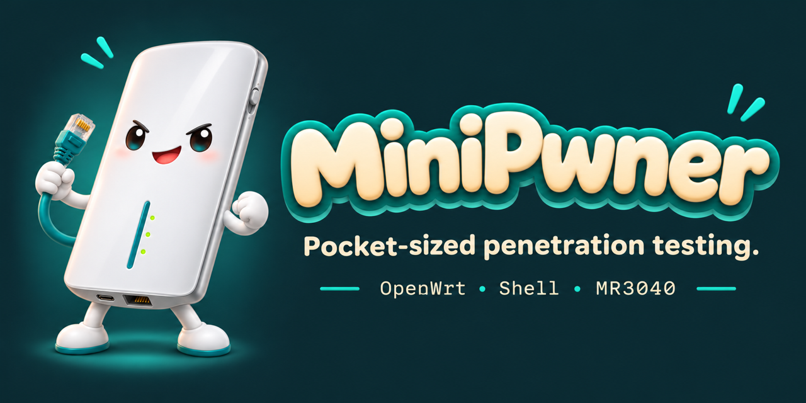

#  MiniPwner

MiniPwner configures a TP-Link MR3040 running OpenWrt as a portable penetration testing device. The router combines wired Ethernet, wireless access, USB storage and battery operation for authorized network assessments.

## Getting started

Read [hardware and installation](docs/getting-started.md) before running `install.sh` on a router. This is a legacy project targeting OpenWrt Barrier Breaker; package availability and device behavior require validation on compatible hardware.

## Documentation

- [Getting started](docs/getting-started.md): prerequisites, installation paths and first checks.
- [Architecture](docs/architecture.md): installer, overlay and MiniModes responsibilities.
- [Local verification](docs/development.md): a small Docker check with isolated installer tests.
- [Brand assets](assets/brand/README.md): identity and artwork usage.

## Local verification

The repository has one Dockerfile and one verification script. See
[local verification](docs/development.md) for the two Docker commands.
The check lints the installer, validates MiniModes shell syntax, and tests
installation from the single packaged overlay in a private temporary tree with restricted system mocks.
No hosted CI is configured.

## License

Copyright © 2026 Nicholas Adamou.

The project is licensed under [PolyForm Shield License 1.0.0](LICENSE), with Nicholas Adamou as the holder. The original MIT notice for earlier code is preserved in [LICENSES/MIT-2018.txt](LICENSES/MIT-2018.txt); see [NOTICE](NOTICE).
