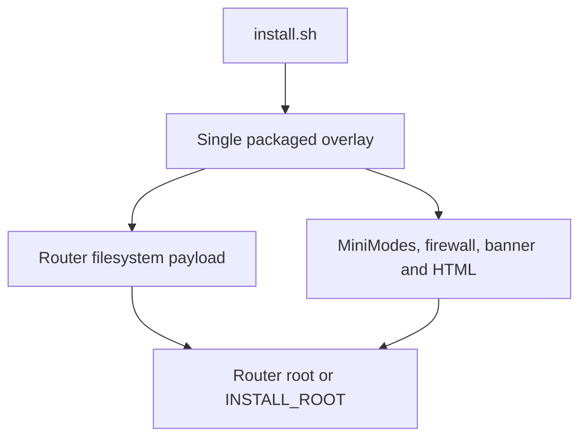

# Architecture

MiniPwner is a shell installer for a small OpenWrt router. The repository keeps
one installer, one packaged overlay, the existing firmware image, documentation,
branding, and licensing.

## Installer and package

`install.sh` reads `OVERLAY/minipwner-overlay_2.0.0.tar` directly. It extracts
the nested filesystem payload and installs the supporting files with their
required permissions. The package remains unchanged and is the only source of
these files; there is no second source payload to maintain. The archived legacy
setup script is retained as part of the package but is not executed.

Installation to `/` requires root. An existing `INSTALL_ROOT` directory supports
unprivileged staging. Installation stops on errors and supports reruns, but does
not roll back partial changes. Staging cannot restart the host.

The existing firmware image remains in `FIRMWARE/` and is separate from the overlay.

## Verification boundary

The Dockerfile and `test.sh` provide ShellCheck, MiniModes syntax validation,
and isolated installer checks against the real package. They compare payload
contents, installed files, permissions, and startup links, and exercise reruns
and failures. They do not flash firmware, reboot, emulate OpenWrt, or test
networking. See [local verification](development.md).
