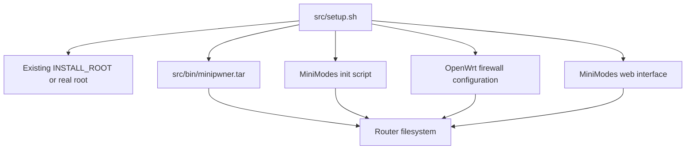

# Architecture

MiniPwner is a shell-based overlay installer for a small OpenWrt router. It has no workstation service to run.

## Installer and payload

`src/setup.sh` requires root for installation to `/`, or accepts an existing unprivileged `INSTALL_ROOT` staging directory. It extracts the bundled archive and copies supporting files without removing the source distribution. It uses local utilities and no network dependencies. `src/bin/minimodes` creates the CGI interface and applies mode selections. Supporting files include firewall configuration, a login banner and HTML.

`FIRMWARE/` holds a historical firmware binary. `OVERLAY/` holds a separately packaged distribution. Neither is executed, flashed or unpacked onto the workstation by local CI.

## Verification boundary

`test/verify.sh` builds a development image and runs static checks, documentation rendering and staged source-installer integration tests. ShellCheck checks the installer without legacy exclusions; MiniModes receives POSIX shell syntax validation. Integration tests execute the actual source entry point against private temporary files, with strict local dependency wrappers. They compare extracted content, copied file modes and startup links, and verify command failure and missing-payload handling. They do not execute the separately packaged historical installer, emulate OpenWrt, exercise networking or prove router runtime behavior.
