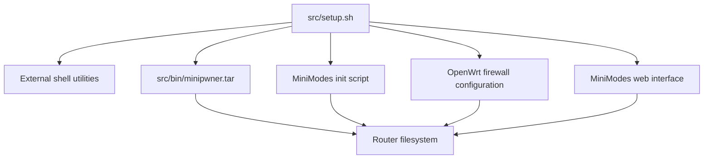

# Architecture

MiniPwner is a shell-based overlay installer for a small OpenWrt router. It has no workstation service to run.

## Installer and payload

`src/setup.sh` loads remote utilities, requests elevated access, extracts an overlay and copies files into the router filesystem. `src/bin/minimodes` creates the CGI interface and applies mode selections. Supporting files include firewall configuration, a login banner and HTML.

`FIRMWARE/` holds a historical firmware binary. `OVERLAY/` holds a separately packaged distribution. Neither is executed, flashed or unpacked onto the workstation by local CI.

## Verification boundary

`test/verify.sh` builds a development image and runs static checks plus documentation rendering. ShellCheck preserves the existing installer-specific exclusions; MiniModes receives POSIX shell syntax validation. These checks do not emulate OpenWrt, validate remote utility availability, exercise networking or prove router runtime behavior.
