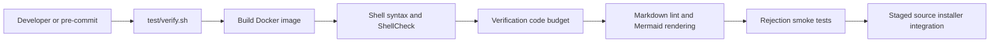

# Local development

## Environment

Install [Flox](https://flox.dev/docs/) and start a Docker engine. The checked-in Flox environment supplies Bun, the Docker client and pre-commit; the engine remains a host prerequisite.

```sh
flox activate -- ./test/verify.sh
flox activate -- pre-commit install
flox activate -- pre-commit run --all-files
```

The hook invokes the exact same `./test/verify.sh` command with no filename filtering. Manual runs check the current working tree, including unstaged changes; normal commit hooks use pre-commit's staged-file handling. Keep Docker running when committing.

## Verification pipeline



The build downloads the Bun base image, Debian packages and locked JavaScript dependencies. Bun installs with a frozen lockfile and disabled lifecycle scripts. At runtime the container has no network, runs as UID 65534, drops capabilities, disallows privilege escalation and uses a read-only filesystem. A 512 MiB `/tmp` tmpfs holds Chromium profiles, rendered diagrams and temporary fixtures; nothing is rendered into the checkout. Chromium uses `--no-sandbox` inside this restricted container.

`test/check.sh` recursively discovers `*.sh` files for Bash syntax and ShellCheck, checks MiniModes POSIX syntax and Markdown style, and renders all Markdown Mermaid fences through the Mermaid CLI and Chromium. `test/failures.sh` injects invalid shell syntax and ShellCheck violations in both existing and newly added source files, Markdown headings and Mermaid diagrams into temporary copies and verifies that the real checks reject each one. The source installer receives full ShellCheck coverage.

The executable 350 nonblank line budget discovers files recursively, so newly added infrastructure counts automatically. It excludes documentation (`*.md`, `docs/`), assets, historical firmware/overlay directories, licenses, generated locks, dependency/Git/Flox runtime directories, the existing banner and the explicitly listed unchanged router payload files. The source installer is counted. New files under `src/` count unless explicitly excluded. `test/budget.sh` contains the exact exclusions and reports the total. A rejection test proves that adding an oversized configuration file fails the budget.

## Update tools

Edit exact dependency versions in `package.json`, then regenerate the lock with Bun:

```sh
flox activate -- bun install --ignore-scripts
flox activate -- ./test/verify.sh
```

Keep the Bun Docker tag and `packageManager` version aligned. Flox packages are resolved in `.flox/env/manifest.lock`; update them with `flox update` and rerun verification. Markdown permits long lines and inline HTML for the existing brand artwork; other default markdownlint rules apply.

See the upstream [Markdown CLI documentation](https://github.com/DavidAnson/markdownlint-cli2) and [Mermaid Markdown rendering documentation](https://github.com/mermaid-js/mermaid-cli#transform-a-markdown-file-with-mermaid-diagrams) for tool behavior.

## Hardware checks

`test/integration.sh` runs the actual `src/setup.sh` entry point in a private `/tmp` staging tree. A restricted PATH and Bash dependency functions permit only approved operations inside that tree; archive entries are checked before extraction. Real local tools then perform extraction, copies, permission changes and symlink creation. Content/mode/link assertions verify their results and ensure source files remain intact. Mock-only `SKIP_COMMAND` fault injection supports checking that omitted extraction, copying, permission changes or symlink creation fail these assertions. Repeated installation is checked. Nonroot installation to `/`, staged restart requests, missing payloads and an injected copy failure must return nonzero; unexpected dangerous commands are denied. The Docker tmpfs remains non-executable, and mocks are sourced as dependency functions rather than executable temporary scripts.

The pipeline does not modify real router configuration, flash firmware, reboot, use network services or test package installation. Validate installation, networking, storage and mode switching on compatible hardware separately.
